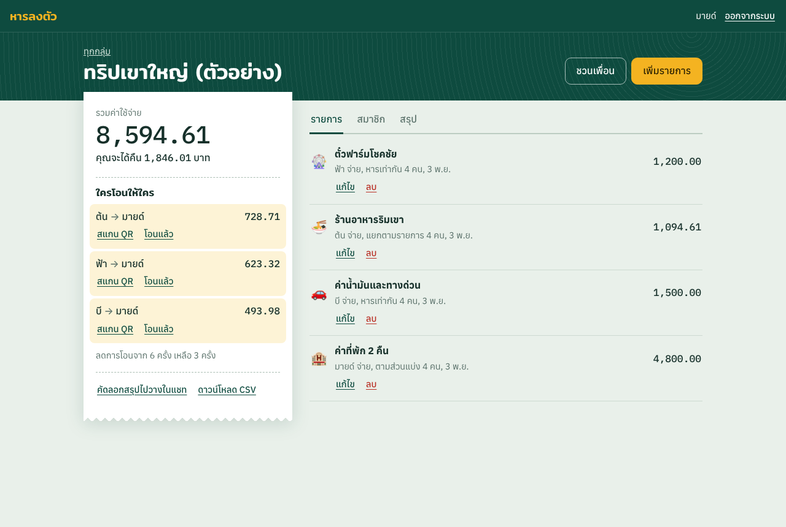

# หารลงตัว (HarLongTua)

เว็บแอปหารค่าใช้จ่ายในกลุ่มเพื่อน จดว่าใครจ่ายอะไร แล้วเว็บจะคำนวณว่าใครต้องโอนให้ใครด้วยจำนวนครั้งที่น้อยลง พร้อม QR พร้อมเพย์สำหรับสแกนจ่าย

โครงงานวิชา 040613204 Object-Oriented Programming
ผู้จัดทำ: 6804062612323 นายธนภัจน์ ขนาบแก้ว (Section 1)



## ความสามารถ

- สมัครสมาชิกและเข้าสู่ระบบ
- สร้างกลุ่ม และชวนเพื่อนด้วยลิงก์หรือ QR ทุกคนเห็นรายการเดียวกัน
- หารได้ 5 แบบ: เท่ากัน, ตามรายการ (มี Service Charge และ VAT), ระบุยอด, เปอร์เซ็นต์, ส่วนแบ่ง
- ลดจำนวนครั้งการโอน และบันทึกการโอนคืน
- สร้าง QR พร้อมเพย์พร้อมยอดเงิน
- สรุปค่าใช้จ่ายตามหมวดหมู่และรายคน คัดลอกสรุปไปวางในแชท และดาวน์โหลด CSV

## เทคโนโลยี

| ส่วน | ที่ใช้ |
|---|---|
| Frontend | TypeScript, Vite, คลาส Component ที่เขียนเอง |
| Backend | Node.js, Express 5, Zod, JWT, bcrypt |
| ฐานข้อมูล | MongoDB (Atlas M0) ผ่าน Mongoose |
| ทดสอบ | Vitest, Supertest |

## โครงสร้างโฟลเดอร์

```
shared/   คลาสหลักของระบบ ใช้ร่วมกันทั้ง Frontend และ Backend
server/   Controller, Service, Repository และ Middleware
client/   หน้าเว็บ
tests/    เทสต์
docs/     ภาพหน้าจอและคลาสไดอะแกรม
```

## รันบนเครื่องตัวเอง

ต้องมี Node.js 20 ขึ้นไป และ MongoDB Atlas หรือ MongoDB ในเครื่อง

```bash
npm install
cp .env.example .env   # แล้วใส่ MONGODB_URI และ JWT_SECRET
npm run dev            # เปิด http://localhost:5173
```

## คำสั่งอื่น

```bash
npm test        # รันเทสต์ (ไม่ต้องใช้ฐานข้อมูล)
npm run build   # สร้างไฟล์สำหรับใช้งานจริงใน dist/
npm start       # รันเว็บจาก dist/
```

## Deploy

เว็บนี้ Deploy บน Netlify แบบฟรีได้ โดยไม่ต้องใช้บัตรเครดิต

1. สร้างฐานข้อมูลฟรีบน MongoDB Atlas (M0) แล้วคัดลอก Connection String
2. บน Netlify เลือก Add new project > Import an existing project แล้วเลือก repo นี้ ระบบจะอ่านค่าจาก `netlify.toml`
3. เพิ่ม Environment Variables ชื่อ `MONGODB_URI` และ `JWT_SECRET` (ข้อความสุ่มยาวอย่างน้อย 32 ตัวอักษร) แล้วกด Deploy

โปรเจกต์นี้มีไฟล์สำหรับ Vercel (`vercel.json` และ `api/index.js`) ด้วย ถ้าใช้ Vercel และแก้โค้ดฝั่ง Backend ให้รัน `npm run build:api` แล้ว commit ไฟล์นี้
